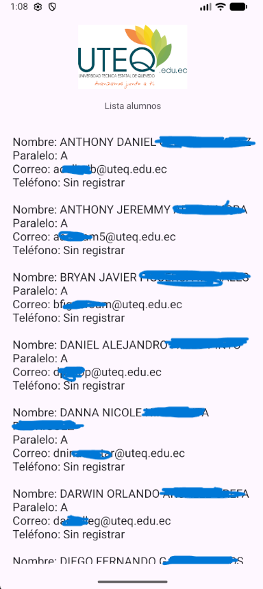

# Lista de alumnos con Supabase

Aplicación Android realizada como práctica de clase. Consulta la tabla `alumnos` de Supabase y muestra los estudiantes ordenados por nombre, con foto, correo y teléfono. También permite consultar las materias por semestre.

**Estudiante:** Loor Medranda Marlon

## Tecnologías

- Kotlin y Android Views
- Supabase PostgREST
- Corrutinas de Kotlin
- Glide para cargar fotos

## Configuración y ejecución

1. Abre el proyecto en Android Studio y sincroniza Gradle.
2. Agrega a `local.properties` la URL del proyecto y su clave pública de Supabase, conservando la configuración del SDK que Android Studio haya generado:

   ```properties
   SUPABASE_URL=https://tu-proyecto.supabase.co
   SUPABASE_KEY=tu-clave-publica
   ```

3. Comprueba que existan las tablas `alumnos` y `materias`, y que sus permisos y políticas permitan la consulta con esa clave. La consulta de materias espera las columnas `id`, `nombre` y `nivel` (número de semestre del 1 al 10).
4. Ejecuta la aplicación en un dispositivo Android con conexión a internet. La lista de alumnos aparece al iniciar; selecciona un semestre para consultar sus materias. La lista muestra todos los alumnos y no se filtra por materia. Para mostrar una foto, el campo `foto` debe contener una URL accesible; si falta, se muestra un ícono predeterminado.

No coloques claves secretas o de servicio en la aplicación ni publiques `local.properties`.

## Captura de pantalla

La aplicación muestra los alumnos obtenidos desde Supabase:


